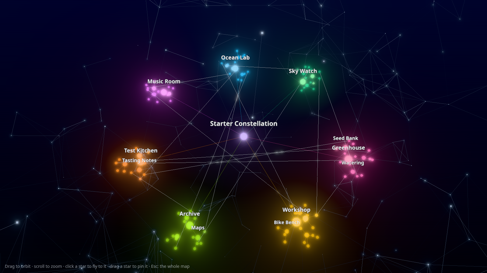

# Constellation starter

Clusters of nodes in 3D, on made-up data. three.js and three-forcegraph lay them out; bloom, link particles and an ambient
mesh make them glow. Edit one JSON file to change the clusters. Drag sliders to change the look.



**Live demo:** https://thubbard2.github.io/constellation-starter/ ·
[Open in StackBlitz](https://stackblitz.com/github/thubbard2/constellation-starter)

## Quick start

You need Node.js 22 or newer (`node -v`). Then:

```bash
git clone https://github.com/thubbard2/constellation-starter
cd constellation-starter
npm ci
npm run dev
```

Open the URL it prints (usually http://localhost:5173).

## What you see

- **One star in the centre** (the root), and **one cloud per cluster** around it, on a tilted ring. A cluster holds groups;
  a group holds items. A faint line joins each node to its parent. Brighter lines are the cross links from the data.
- **Bloom:** bright stars glow (three's `UnrealBloomPass`).
- **Link particles:** small dots run along the cross links and the focused node's links (three-forcegraph).
- **The ambient mesh:** a field of drifting points around the map. Near points join with faint lines. Points near the
  pointer move away (or reach for it, in the `mesh` style).
- A star's size follows how many items are under it. Its colour is its cluster's. A node that changed lately (`daysAgo`)
  is brighter and a little warmer.
- Names show where they have room. Fly in to see more of them.

| Do this | And this happens |
|---|---|
| Drag / scroll / right-drag | orbit / zoom / pan |
| Hover a star | its links and neighbours light up; the rest dims |
| Click a star | the camera flies to it and its children |
| Drag a star | it stays where you drop it (a faint ring); `u` over it lets it go |
| `e` | opens the focus: its children spread out and show their names |
| `Esc` or `h` | back to the whole map |

In the URL: `?focus=Ocean%20Lab` starts on a node; `?stats` shows the frame time (p95).

## Edit the data

Everything comes from `data/clusters.json`:

```json
{
  "title": "Starter Constellation",
  "clusters": [
    {
      "name": "Ocean Lab",
      "color": "#38bdf8",
      "groups": [
        { "name": "Tide Pools", "items": ["Hermit crab census", { "name": "Kelp growth log", "daysAgo": 0, "note": "Grew 30 cm" }] }
      ]
    }
  ],
  "links": [["Kelp growth log", "Seaweed salad"]]
}
```

- A **cluster** has a `name` and `groups`, and may have a `color`, `daysAgo` and a `note`.
- A **group** has a `name` and `items`, and may have `daysAgo` and a `note`.
- An **item** is its name, or `{ "name": …, "daysAgo": …, "note": … }`.
- **`links`** are pairs of names. Every name must be different, so a link can find it.
- Save the file and the page reloads. A mistake shows on the page in plain words, with the field that is wrong, for
  example `clusters[2].groups[0].name is missing. Every group needs a name.`

## Edit the look

- The **Look** panel (top right) changes the style live: bloom, exposure, links, particles, nodes, the mesh and the
  layout's physics. The picker switches between the three styles: `galaxy`, `mesh` and `minimal`.
- **Copy JSON** copies the style. Paste it over `styles/galaxy.json` (or `mesh.json`, `minimal.json`) to keep it.
- `AGENTS.md` lists every key.

## Commands

| Command | What it does |
|---|---|
| `npm run dev` | the dev server, with hot reload |
| `npm test` | the tests (vitest): the data model, the camera tween and the panel |
| `npm run build` | the static site, in `dist/` |
| `npm run preview` | serves the built site |

## How it works

```text
data/clusters.json
  → loadClusters (src/data.ts)          checks the file, builds the tree
  → constellation (src/model/)          clusters, links, sizes, warmth, the layout's forces
  → createConstellationScene (src/scene.ts)
      three-forcegraph + d3-force-3d    lays the stars out in 3D
      three.js EffectComposer           scene → bloom → names → output
```

`AGENTS.md` has the file map, the render pipeline and the performance budget.

## Credits

- [three.js](https://threejs.org/) (MIT)
- [three-forcegraph](https://github.com/vasturiano/three-forcegraph) and d3-force-3d by Vasco Asturiano (MIT)
- [lil-gui](https://lil-gui.georgealways.com/) (MIT)
- [Vite](https://vite.dev/) and [Vitest](https://vitest.dev/) (MIT)
- The ambient mesh borrows its idea from [particles.js](https://github.com/VincentGarreau/particles.js) (MIT).

The data is made up. The code is MIT: see `LICENSE`.
